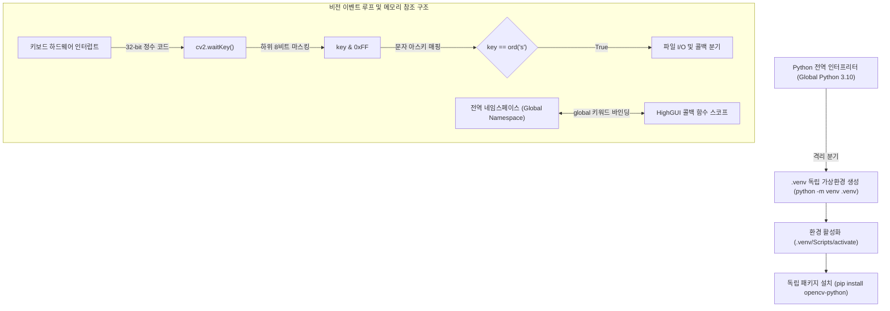

# 00_python_basics: 개발 환경 설정 및 파이썬 핵심 문법

## 1. 핵심 학습 목표 및 기본 개념
- **가상환경 격리(venv) 및 패키지 충돌 방지:** 전역 인터프리터의 패키지 버전 간섭(OpenCV 3.x vs 4.x 충돌)을 방지하기 위해 독립적인 `.venv` 환경을 구축하고 `pip`로 의존성을 제어함.
- **아스키 변환 및 비트 마스킹 메커니즘:** 키보드 입력을 처리하기 위한 `ord()`/`chr()` 함수 및 운영체제별 32비트 키 코드를 단일 바이트로 정규화하는 `& 0xFF` 비트 연산 원리를 습득함.
- **다차원 슬라이싱 및 스코프 제어:** 이미지 픽셀 매트릭스를 다루는 NumPy 다차원 인덱싱(`[y1:y2, x1:x2]`)과 비동기 GUI 콜백 함수 내 상태 유지를 위한 `global` 스코프 키워드를 이해함.

## 2. 파일별 전수 기능 인벤토리 (누락 금지)
| 파일명 | 핵심 동작 | 사용된 주요 함수 / 파이썬 문법 | 주의해야 할 점 |
|---|---|---|---|
| `01_env_and_syntax.py` | 가상환경 인터프리터 경로 검증 및 OpenCV 필수 연계 문법(`ord`, `chr`, `& 0xFF`, `pathlib`, `global`, 다차원 슬라이싱) 동작 테스트 | `sys.executable`, `ord()`, `chr()`, `Path(__file__).resolve()`, `global`, List Comprehension | `ord()`에 2글자 이상 전달 시 `TypeError`, 전역 변수 수정 시 `global` 선언 누락 시 `UnboundLocalError` 발생 주의 |

## 3. 핵심 파이프라인 및 데이터 흐름

## 4. 실무 함정 및 런타임 엣지 케이스 (Gotchas)
- **전역 인터프리터 오염 및 DLL 로딩 충돌:** 시스템 전역 파이썬에 여러 OpenCV 버전(`opencv-python`, `opencv-contrib-python`)이 혼재되어 설치되면 C++ 바이너리 DLL 충돌(`ImportError: DLL load failed`)이 발생하므로 반드시 프로젝트 루트 단위로 `.venv`를 생성하여 분리 실행해야 함.
- **키 입력 32비트 정수 오버플로 및 플랫폼 종속성:** 64비트 Windows 및 Linux X11 환경에서 `cv2.waitKey()`는 NumLock 등의 키 상태에 따라 상위 비트가 채워진 32비트 정수를 반환함. `key == ord('q')`로 직접 비교하면 상위 비트 불일치로 탈출하지 못하는 무한 루프가 발생하므로 반드시 `key & 0xFF == ord('q')`로 방어 코드를 작성해야 함.
- **콜백 내부 불변(Immutable) 변수 언바운드 에러:** GUI 트랙바 콜백 등에서 전역 정수형(`int`) 변수를 읽기만 할 때는 문제가 없으나, 값을 재할당(`bold = value`)할 경우 파이썬은 이를 지역 변수로 간주하여 `UnboundLocalError`를 발생시킴. 콜백 진입 즉시 `global bold`를 명시해야 함.
