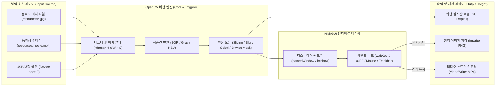

# OpenCV & Python Computer Vision 실습 프로젝트 종합 가이드

본 저장소는 Python 및 OpenCV(Open Source Computer Vision) 라이브러리를 활용하여 디지털 영상 처리의 기초부터 동영상 스트리밍, 카메라 하드웨어 인터페이스, HighGUI 기반 대화형 이벤트 제어까지 단계별로 학습할 수 있도록 구성된 실습 코드베이스입니다.

모든 소스 코드는 OS 독립적 파일 경로 탐색(`pathlib.Path`), 엄격한 파이썬 스코프 분리(`global`), NumPy 다차원 슬라이싱 및 비트 단위 마스킹 기법을 준수하여 작성되었습니다.

---

## 1. 전체 디렉토리 아키텍처 및 하위 README 링크

| 디렉토리 / 모듈 | 핵심 실습 주제 | 포함된 주요 기능 및 학습 내용 | 하위 README 링크 |
|---|---|---|:---:|
| **`00_python_basics/`** | 개발 환경 설정 & 파이썬 기초 | Python 가상환경(`.venv`), 패키지 의존성 격리, `ord()`/`chr()` 아스키 변환, 다차원 슬라이싱, `global` 스코프 | [00_python_basics/README.md](./00_python_basics/README.md) |
| **`01_image/`** | 이미지 기본 처리 & 비트 연산 | 정적 이미지 I/O (`imread`/`imwrite`), BGR/HSV/Gray 색공간 변환, ROI 크롭/리사이즈, 이진화, 블러링, Sobel 에지 검출, 비트 AND/OR/NOT 마스킹 | [01_image/README.md](./01_image/README.md) |
| **`02_movie/`** | 동영상 스트림 제어 & 녹화 | 비디오 컨테이너 디코딩 (`VideoCapture`), FPS 동적 딜레이 계산, 무한 반복 재생 루프, 실시간 프레임 캡처(PNG) 및 비디오 인코딩 녹화(`VideoWriter`) 상태 머신 | [02_movie/README.md](./02_movie/README.md) |
| **`03_camera/`** | 하드웨어 카메라 스트리밍 | USB 웹캠 장치 열기, OS별 미디어 백엔드(Windows `CAP_DSHOW`, macOS `CAP_AVFOUNDATION`), 카메라 해상도 동적 설정 및 디바이스 자원 생명주기 관리 | [03_camera/README.md](./03_camera/README.md) |
| **`04_gui/`** | HighGUI 대화형 인터페이스 | 마우스 이벤트 콜백(`setMouseCallback`), 다중 트랙바 슬라이더 바인딩, 동적 기하 도형 및 텍스트 오버레이, 전역 변수 기반 실시간 파라미터 튜닝 | [04_gui/README.md](./04_gui/README.md) |
| **`resources/`** | 공용 테스트 에셋 저장소 | 실습용 정적 이미지(`jang.jpg`, `tomato.jpg` 등), 마스크 레이어(`layer.png`), 샘플 비디오(`movie.mp4`), 캡처 및 녹화 결과물 저장 경로 | - |

---

## 2. 전체 비전 프로세싱 파이프라인 개요



---

## 3. 개발 환경 구축 및 가상환경 설정 가이드

### 1) Python 가상환경(`.venv`) 생성 및 활성화
프로젝트 간 라이브러리 버전 충돌을 원천 차단하기 위해 가상환경을 필히 사용합니다.

- **Windows (Command Prompt / PowerShell):**
  ```cmd
  python -m venv .venv
  .venv\Scripts\activate
  ```
- **macOS / Linux:**
  ```bash
  python3 -m venv .venv
  source .venv/bin/activate
  ```

### 2) 필수 의존성 패키지 설치
```bash
pip install --upgrade pip
pip install opencv-python numpy
```

### 3) 설치 정상 검증
```python
python -c "import cv2, numpy; print('OpenCV Version:', cv2.__version__); print('NumPy Version:', numpy.__version__)"
```
