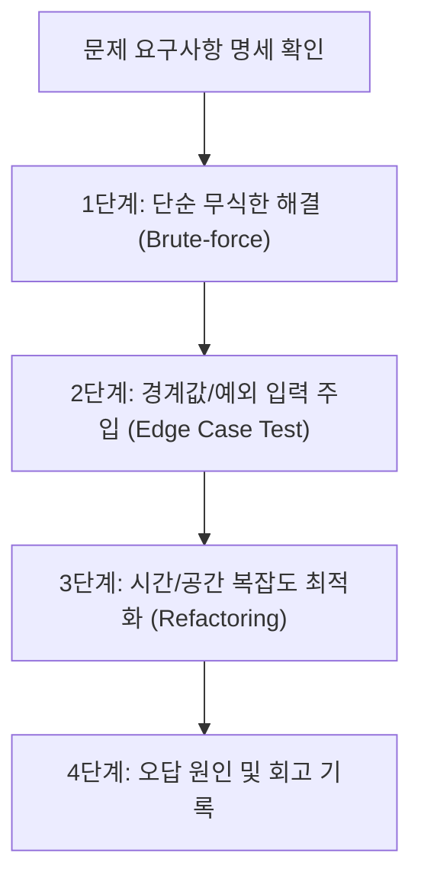

# 파이썬 문제 풀이 및 해설 (`_문제풀이/`)

본 디렉토리는 `문제/`에 제시된 요구사항을 직접 프로그래밍 언어로 구현하고, 성능 분석(시간/공간 복잡도)과 엣지 케이스 디버깅 과정을 기록하는 **해설 및 풀이 보관소**입니다.

---

## 1. 풀이 진행 파이프라인

단순히 통과하는 코드를 넘어 확장성과 효율성을 고려한 4단계 작성 흐름입니다.



---

## 2. 문제 풀이 전수 매핑 테이블 (Solution Map)

| 풀이 파일명 | 원본 대응 문제 | 주요 알고리즘 / 접근법 | 시간 복잡도 | 공간 복잡도 |
|---|---|---|---|---|
| `sol_01.py` | 문제 1 | 단일 패스 분기 평가 (Short-circuit 활용) | $O(1)$ | $O(1)$ |
| `sol_02.py` | 문제 2 | 투 포인터(Two-pointer) 기반 반복 탐색 | $O(N)$ | $O(1)$ |
| `sol_03.py` | 문제 3 | 해시 테이블(`dict`) 기반 빈도 카운팅 | $O(N)$ | $O(N)$ |
| `sol_04.py` | 문제 4 | 함수형 매핑(`map`, `filter`) 및 튜플 언패킹 | $O(N)$ | $O(N)$ |
| `sol_05.py` | 문제 5 | 정렬 및 슬라이싱 최적화 파이프라인 | $O(N \log N)$ | $O(N)$ |

---

## 3. 대표 구현 패턴 및 최적화 비교

### 예시: 리스트 빈도수 집계 최적화 (`sol_03.py`)

#### ❌ 나쁜 패턴 (시간복잡도 $O(N^2)$)
```python
# count()를 매 반복마다 호출하여 비효율적인 전체 재탐색 발생
def bad_frequency(elements: list) -> dict:
    res = {}
    for x in elements:
        res[x] = elements.count(x)  # elements.count() 내부에서 O(N) 순회
    return res
```

#### ✅ 개선 패턴 (시간복잡도 $O(N)$)
```python
# 해시 테이블을 활용한 단일 순회 집계
def optimized_frequency(elements: list) -> dict:
    res = {}
    for x in elements:
        res[x] = res.get(x, 0) + 1
    return res
```

---

## 4. 실전 디버깅 및 함정 회고 (Gotchas & Retrospective)

### ① 빈 입력값 및 경계 조건(Boundary Conditions) 누락
* 입력 리스트가 비어 있거나(`[]`), 문자열의 길이가 0일 때 `IndexError`가 터지지 않도록 선행 방어 조건(`if not elements: return ...`)을 루틴화해야 합니다.

### ② 나눗셈 연산자 사용 시 ZeroDivisionError
* 평균값 계산 시 분모가 0이 되는 케이스를 사전 검사해야 합니다:
  ```python
  # 안전한 평균 연산
  avg = (sum(scores) / len(scores)) if scores else 0.0
  ```

### ③ 전역 네임스페이스 오염 방지
* 풀이 스크립트를 다른 모듈에서 임포트하여 채점할 수 있도록, 독립 실행 블록(`if __name__ == "__main__":`) 밖에는 오직 함수와 클래스 정의만 위치시켜야 합니다.