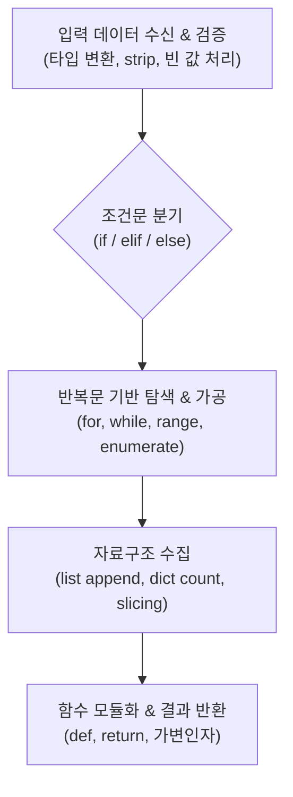

# 파이썬 문제 풀이 학습 기록 (`_문제풀이/`)

`문제/` 폴더에 출제된 연습 문제를 직접 풀어보며, 파이썬의 기본 문법(조건 분기, 루프 제어, 함수 설계, 자료구조 가공)을 실무 코드로 전환하는 과정을 정리한 학습 요약 문서입니다.

---

## 1. 지금까지 배운 핵심 개념 체계

문제들을 해결하면서 다룬 파이썬 코어 개념의 연결 고리입니다.



---

## 2. 파일별 학습 내용 및 구현 요약 (Learning Log)

각 문제를 풀면서 **어떤 문법을 활용했고, 무엇을 배웠는지** 파일 단위로 요약한 명세입니다.

| 풀이 파일명 | 대응 주제 | 핵심 구현 내용 | 배운 점 및 핵심 개념 (Takeaway) |
|---|---|---|---|
| `sol_01.py` | 조건문 & 경계값 판별 | `if-elif-else` 다중 조건식, 비교/논리 연산자(`and`, `or`) | • 조건 평가 시 앞선 조건이 참이면 뒤를 보지 않는 **단축 평가(Short-circuit evaluation)** 원리<br/>• 음수, 0, 잘못된 입력값이 들어왔을 때의 예외 분기 처리 습득 |
| `sol_02.py` | 반복 제어 & 흐름 조작 | `for`문 시퀀스 순회, `break` 및 `continue` 활용 | • 불필요한 반복을 즉시 중단하는 `break`를 통한 연산 낭비 방지<br/>• 특정 조건을 건너뛰는 `continue`로 들여쓰기 뎁스(Depth)를 줄이는 클린 코드 작성법 체득 |
| `sol_03.py` | 리스트 & 인덱싱/슬라이싱 | 리스트 컴프리헨션, `[start:end:step]` 슬라이싱 | • 원본 리스트를 변형하지 않고 원하는 구간의 요소를 빠르게 추출하는 슬라이싱 문법 익힘<br/>• `for` 루프 + `append` 구조를 간결한 리스트 컴프리헨션으로 압축하는 방법 습득 |
| `sol_04.py` | 딕셔너리 기반 집계 | `dict.get()`, Key-Value 순회, 카운팅 로직 | • `KeyError` 없이 안전하게 값을 꺼내는 `get(key, default)` 메서드 활용법<br/>• 대량 데이터에서 특정 항목의 빈도수를 효율적으로 집계하는 해시 자료구조 활용 체득 |
| `sol_05.py` | 함수 정의 및 스코프 | `def`, 매개변수 기본값, 반환값(`return`), 스코프 | • 함수 내부 로컬 변수와 외부 글로벌 변수 간의 생명주기(Scope) 이해<br/>• 하나의 작업만 책임지는 단일 책임 함수 설계와 다중 반환값(Tuple Unpacking) 처리 습득 |

---

## 3. 실습을 통해 체득한 핵심 코드 패턴

### ① 안전한 딕셔너리 카운팅 (`get` 메서드)
문제를 풀며 가장 빈번하게 발생했던 `KeyError`를 방지하는 표준 집계 패턴을 학습했습니다.

```python
# 배운 패턴: 키가 없으면 0을 반환하고 바로 1을 더해 누적
counts = {}
for item in data:
    counts[item] = counts.get(item, 0) + 1
```

### ② 리스트 순회 인덱스와 값 동시 추출 (`enumerate`)
`range(len(list))` 대신 인덱스와 요소를 한 번에 꺼내 가독성을 높이는 방식을 익혔습니다.

```python
# 배운 패턴: enumerate로 인덱스와 값을 동시에 안전하게 바인딩
for idx, val in enumerate(targets):
    if val == target_value:
        print(f"인덱스 {idx}에서 발견: {val}")
```

### ③ 조기 반환(Early Return)을 통한 들여쓰기 최소화
중첩된 `if`문을 줄이기 위해 잘못된 입력이 들어오면 함수 시작부에서 즉시 탈출하도록 구현했습니다.

```python
def process_data(data):
    # 유효하지 않은 데이터는 초기에 걸러내고 즉시 종료
    if not data:
        return None
    
    # 정상 흐름에서는 들여쓰기 깊이 없이 선형적으로 작성
    result = [x * 2 for x in data]
    return result
```

---

## 4. 문제 풀이 과정의 시행착오 및 디버깅 회고

1. **인덱스 범위 초과 (`IndexError`):**
   * 리스트 끝자락을 슬라이싱하거나 루프 인덱스를 직접 다룰 때 `len()`과의 오프셋 차이로 런타임 에러가 자주 발생함 $\rightarrow$ 인덱스를 직접 조작하기보다 파이썬의 이터레이터(`for item in list`)를 쓰는 습관을 들임.
2. **참조 복사로 인한 원본 훼손:**
   * `b = a` 형태로 리스트를 대입한 뒤 `b.append()`를 수행했을 때 원본 `a`까지 바뀌는 얕은 복사 문제 경험 $\rightarrow$ `b = a.copy()` 또는 `a[:]` 슬라이싱 복사를 적용함.
3. **가변 인자 기본값 버그:**
   * 함수 정의 시 `def add(item, lst=[]):`로 뒀을 때 이전 호출의 데이터가 누적되는 현상 확인 $\rightarrow$ `lst=None` 패턴으로 방어하는 표준 기법을 체득함.
