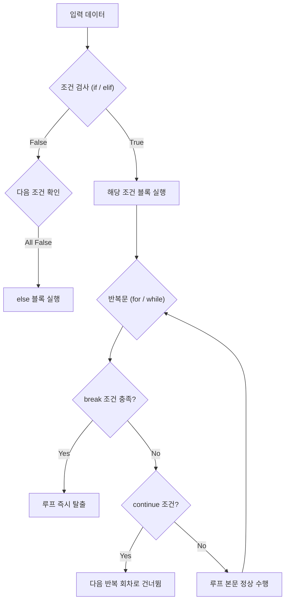

# Python 프로그래밍 기초 및 프로젝트 인덱스

본 저장소는 파이썬 기본 문법(조건문, 반복문, 함수)을 다루는 Jupyter Notebook 및 스크립트 예제와, 단계별 문제 풀이 및 OpenCV 컴퓨터 비전 실습을 체계적으로 구조화한 저장소입니다.

---

## 1. 전체 디렉토리 및 프로젝트 구조

```text
.
├── 4. Conditional statement.ipynb   # 조건문(if, elif, else) 및 논리 연산자 실습
├── 5. repeat statement.ipynb        # 반복문(for, while, range, 제어 키워드) 실습
├── 6. function.ipynb                # 함수 선언(def), 가변 인자, 스코프 실습
├── 10.py                            # 기초 알고리즘 및 데이터 처리 실습 스크립트 1
├── 12.py                            # 제어 흐름 및 함수 조합 실습 스크립트 2
├── test.py                          # 라이브러리 로드 및 빠른 단위 기능 검증 스크립트
├── requirements.txt                 # 프로젝트 필수 의존성 패키지 명세
├── README.md                        # 루트 프로젝트 인덱스 및 환경 설정 가이드
├── opencv/                          # 컴퓨터 비전 기초 및 HighGUI 제어 실습 모듈
├── _문제풀이/                       # 과제 및 실습 문제 풀이 코드 보관소
└── 문제/                            # 학습 평가용 원본 문제 세트
```

### 하위 프로젝트 핵심 디렉토리 역할

* **`opencv/`**: OpenCV 기본 입출력, BGR/HSV 색공간 변환, 마스크 비트 연산, 동영상/웹캠 스트리밍 및 GUI 트랙바 실습 코드가 모여 있는 컴퓨터 비전 전용 모듈입니다. (내부에 자체 상세 `README.md` 포함)
* **`문제/`**: 파이썬 문법 이해도와 알고리즘 사고력을 기르기 위해 구성된 원본 문제 세트입니다.
* **`_문제풀이/`**: `문제/`에 제시된 요구사항을 직접 코드로 작성하고 디버깅한 풀이 소스 및 해설이 보관되는 디렉토리입니다.

---

## 2. 루트 파일 전수 인벤토리 (Full Inventory)

| 파일명 | 포맷 | 핵심 다루는 내용 및 주요 문법 | 상세 설명 및 유의점 |
|---|---|---|---|
| `4. Conditional statement.ipynb` | Jupyter Notebook | `if`, `elif`, `else`, 삼항 연산자, 논리 연산자(`and`, `or`, `not`) | 조건식 평가 순서(Short-circuit evaluation) 및 들여쓰기(Indentation) 규칙 실습 |
| `5. repeat statement.ipynb` | Jupyter Notebook | `for`, `while`, `range()`, `enumerate()`, `zip()`, `break`, `continue` | 시퀀스 순회 패턴 및 `while` 루프 종료 조건 미달로 인한 무한 루프 방지 |
| `6. function.ipynb` | Jupyter Notebook | `def`, 위치/키워드 인자, 기본값 매개변수, 가변 인자(`*args`, `**kwargs`), `return` | 함수 스코프(Local vs Global) 분리 및 가변 객체(Mutable) 기본값 전달 위험성 파악 |
| `10.py` | Python Script | 기초 문법 적용 및 데이터 입출력 처리 | 단일 실행 단위 예제 코드 |
| `12.py` | Python Script | 제어 흐름 및 함수 조합 응용 | 단일 실행 단위 예제 코드 |
| `test.py` | Python Script | 환경 점검 및 단위 기능 테스트 | 모듈 임포트 동작 검증 및 문법 디버깅용 임시 코드 |
| `requirements.txt` | Config File | `opencv-python`, `numpy` 등 외부 의존성 목록 | 가상환경 환경 격리 및 배포 재현성 보장용 명세 |

---

## 3. 핵심 문법 메커니즘 (Core Mechanics)

### 3.1. 제어문 및 반복 실행 흐름 파이프라인
파이썬의 조건 분기와 루프 탈출 제어 흐름 구조입니다.



---

## 4. 실무 함정 및 런타임 주의사항 (Gotchas)

### ① 함수 기본 인자(Default Argument)에 가변 객체(Mutable) 사용 금지
```python
# 잘못된 패턴: target_list가 함수 정의 시점에 1회만 생성되어 호출 간에 데이터가 누적됨
def add_item(item, target_list=[]):
    target_list.append(item)
    return target_list

# 방어 패턴: None을 기본값으로 두고 런타임에 인스턴스를 동적으로 생성
def add_item(item, target_list=None):
    if target_list is None:
        target_list = []
    target_list.append(item)
    return target_list
```

### ② 순회 중인 리스트 요소 직접 삭제(Mutation) 금지
* `for x in my_list:` 내부에서 `my_list.remove(x)`를 호출하면 내부 인덱스가 한 칸씩 앞으로 당겨지며 다음 요소가 검사 없이 건너뛰어지는 결함이 발생합니다.
* 반드시 리스트 컴프리헨션(`[x for x in my_list if condition]`)을 쓰거나 복사본(`for x in my_list[:]:`)을 순회해야 합니다.

### ③ 가상환경 격리 및 설치 규칙
시스템 전역(Global)에 패키지를 설치하면 다른 프로젝트와의 버전 충돌이 발생하므로 반드시 가상환경 활성화 후 의존성을 설치합니다.

```bash
# 가상환경 생성 (.venv)
python -m venv .venv

# 가상환경 활성화
# Windows:
.venv\Scripts\activate
# macOS/Linux:
source .venv/bin/activate

# 의존성 패키지 일괄 설치
pip install -r requirements.txt
```