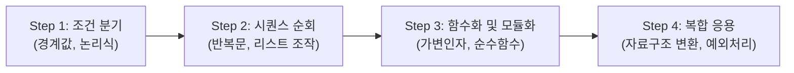

# 파이썬 프로그래밍 원본 문제 세트 (`문제/`)

본 디렉토리는 조건문, 반복문, 함수 및 복합 자료구조(List, Dict, Tuple, Set)의 이해도를 검증하기 위해 출제된 **원본 문제 세트 및 요구사항 명세**를 보관하는 공간입니다.

> **원칙:** 이 디렉토리 내의 원본 문제 명세는 수정하지 않으며, 실제 구현 코드와 해설은 `_문제풀이/` 디렉토리에 분리하여 작성합니다.

---

## 1. 문제 해결 평가 로드맵

문제 세트는 단계별 문법 숙련도와 계산 복잡도 고려 능력을 검증하도록 구성되어 있습니다.



---

## 2. 출제 문제 전수 인벤토리 (Problem Inventory)

| 문제 ID / 파일명 | 평가 핵심 문법 | 입출력 요구사항 (I/O) | 권장 제약조건 (Constraints) |
|---|---|---|---|
| `문제 1` (기초 분기) | `if-elif-else`, 삼항 연산자 | 정수/문자열 입력 판별 및 조건부 포맷팅 출력 | 음수, 공백 문자열 입력 시 방어 처리 |
| `문제 2` (반복 제어) | `for`, `while`, `break`, `continue` | 리스트 내 타깃 요소 탐색 및 필터링 집계 | 외부 모듈 사용 없이 순수 기본 반복문만 사용 |
| `문제 3` (데이터 집계) | `dict`, `zip`, `enumerate` | 빈도수(Count) 산출 및 Key-Value 역매핑 | 원본 리스트 수정(In-place mutation) 금지 |
| `문제 4` (함수 추상화) | `def`, `*args`, `**kwargs`, Return | 가변 인자 기반 수치 연산 및 결과 튜플 반환 | 전역 변수(`global`) 사용 금지 (순수 함수 구현) |
| `문제 5` (응용 구현) | 제어문 + 함수 종합 결합 | 구조화된 텍스트/로그 파싱 및 결과 정렬 | 시간복잡도 $O(N^2)$ 미만 유지 |

---

## 3. 풀이 작성 규격 가이드

`_문제풀이/` 폴더에 풀이 코드를 제출할 때 준수해야 할 표준 인터페이스 규칙입니다.

### ① 함수 단위 구현 원칙
* 모든 문제 풀이는 글로벌 스크립트 실행 형태가 아닌, 입력값을 인자로 받고 결과를 반환하는 **독립 함수** 형태로 작성합니다.

```python
# 올바른 풀이 작성 규격
def solution(data: list) -> dict:
    """
    Args:
        data (list): 입력 데이터 시퀀스
    Returns:
        dict: 처리 완료된 집계 딕셔너리
    """
    result = {}
    # 구현부
    return result
```

### ② 테스트 케이스 자체 검증
* 소스 파일 하단에 `if __name__ == "__main__":` 블록을 두고 최소 3개 이상의 검증 케이스(`assert` 문)를 포함해야 합니다.

```python
if __name__ == "__main__":
    assert solution([1, 2, 2, 3]) == {1: 1, 2: 2, 3: 1}
    assert solution([]) == {}
    print("All test cases passed!")
```